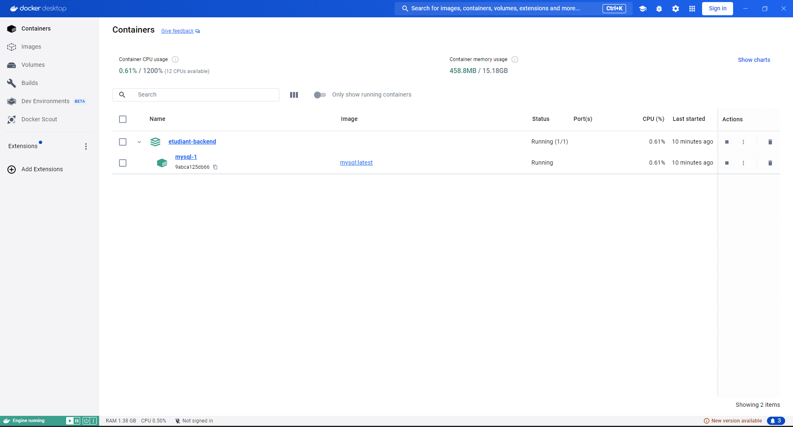
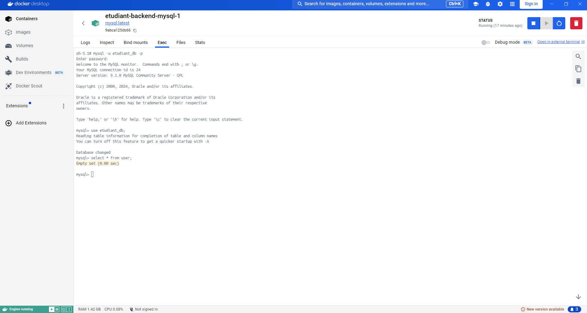

# MS etudiant-backend

API REST qui gère les comptes des agents de la bibliothèque et les étudiants.

- name : `etudiant-backend`
- port : `8080`

Prérequis, fichier `.env` et démarrage : voir le [README à la racine](../README.md).

## Démarrage

Depuis ce dossier (le fichier `.env` est lu dans le dossier courant) :

```
./mvnw spring-boot:run
```

Sous Windows : `mvnw.cmd spring-boot:run`

Cette commande :
- démarre le conteneur MySQL décrit dans `compose.yaml` ;
- lance l'API et la connecte à la base.

Le démarrage est terminé quand les logs affichent :

```
Exposing 1 endpoint beneath base path '/actuator'
Tomcat started on port 8080 (http) with context path '/'
Started EtudiantBackendApplication in ... seconds
```

## Routes de l'API

Sans authentification :

- `/api/register`
- `/api/login`
- `/actuator/health`

Toute autre route demande une authentification.

## Accéder à la base de données

L'utilisateur et le nom de la base sont déjà connus du conteneur (variables du `.env`, voir le README à la racine) :

```
docker exec -it back-mysql-1 sh -c 'mysql -u "$MYSQL_USER" --database="$MYSQL_DATABASE" -p'
```

Le mot de passe demandé est celui de `DB_PASSWORD`. Puis :

```
select * from user;
```

Avec Docker Desktop, dans l'onglet `Exec` du conteneur `mysql-1` :

```
mysql -u "$MYSQL_USER" --database="$MYSQL_DATABASE" -p
```





## Exécution des tests

Docker doit être démarré : les tests d'intégration créent une base MySQL temporaire avec Testcontainers.

```
./mvnw clean test
```
